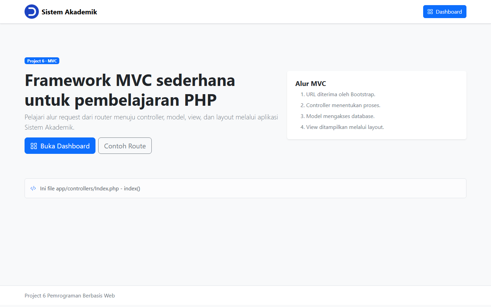
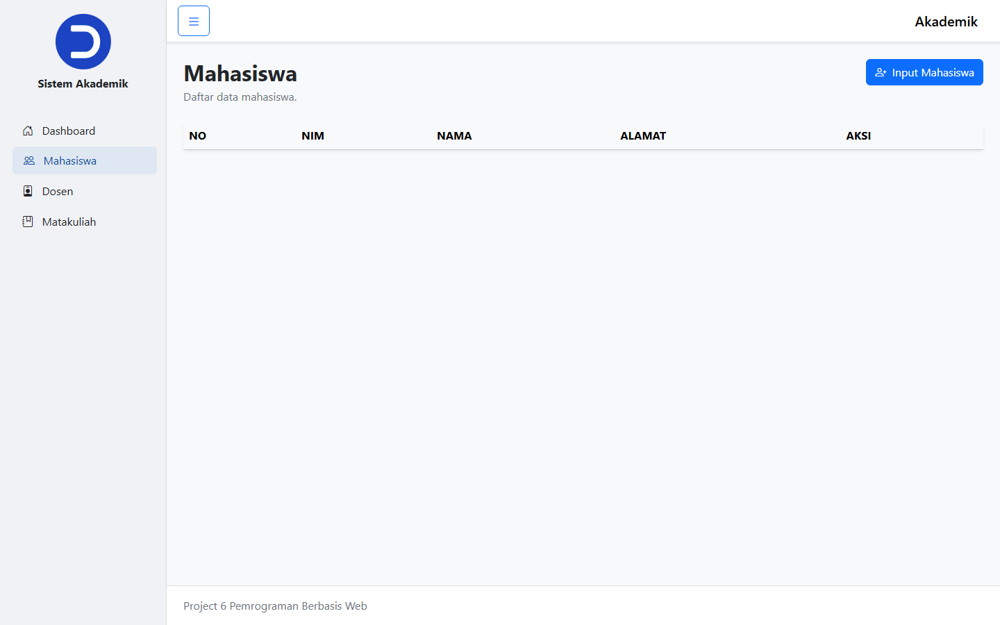
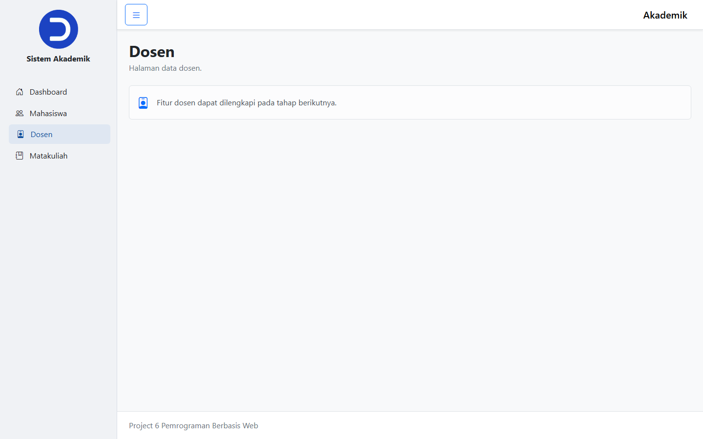
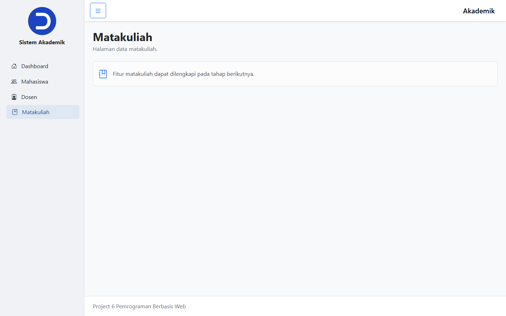
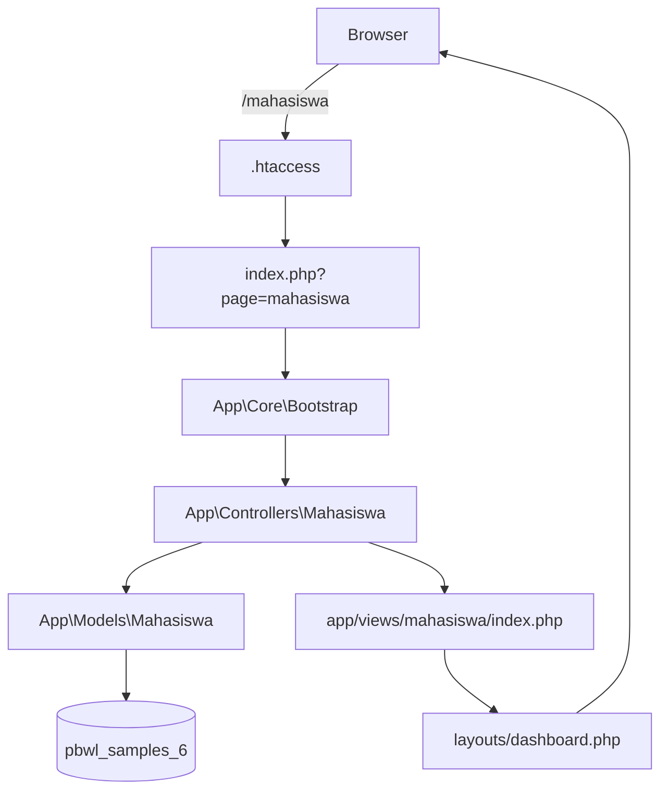

<div align="center">

# 🏗️ Sistem Akademik Project 6

**Project 6 · MVC Sederhana (tanpa framework)**

Framework **MVC buatan sendiri** untuk Sistem Akademik: router, controller dasar, dan model dasar ditulis dari nol.

     

</div>

## 📖 Deskripsi

`.htaccess` mengubah URL menjadi `index.php?page=...`. `App\Core\Bootstrap` memetakan URL ke `Controller@action`, controller memanggil model, lalu view dirender di dalam layout. Tidak ada framework semua lapisan terlihat jelas.

## 📸 Tampilan

<table>
 <tr>
 <td width="50%"><br><sub>Dashboard</sub></td>
 <td width="50%"><br><sub>Modul Mahasiswa</sub></td>
 </tr>
 <tr>
 <td width="50%"><br><sub>Modul Dosen</sub></td>
 <td width="50%"><br><sub>Modul Matakuliah</sub></td>
 </tr>
</table>

## ✨ Fitur

- 🧭 Router sendiri via `.htaccess` + `Bootstrap.php`
- 🎮 Controller: Index, Dashboard, Mahasiswa, Dosen, Matakuliah
- 🧠 Model dasar dengan koneksi PDO
- 👁️ View per modul di `app/views/`
- 🎨 Layout guest & dashboard di `layouts/`
- 🛑 Halaman 404 khusus
- ⚙️ Autoload Composer PSR-4

## 🧱 Teknologi

| Lapisan | Teknologi |
| --- | --- |
| Arsitektur | MVC buatan sendiri |
| Routing | `mod_rewrite` → `?page=` |
| Bahasa | PHP 8.0+ |
| Database | MySQL (PDO) |
| Autoload | Composer PSR-4 |

## 🏗️ Arsitektur



## 🚀 Instalasi

1. Aktifkan `mod_rewrite` Apache.
2. Import `database.sql` ke `pbwl_samples_6`.
3. Buka **http://localhost/project6/**.

## 🗂️ Struktur

```
project6/
├── app/
│ ├── core/ # Bootstrap, Controller, Model, Error
│ ├── controllers/ # Index, Dashboard, Mahasiswa, Dosen, Matakuliah
│ ├── models/
│ └── views/ # per modul + error/404
├── inc/
├── layouts/
├── .htaccess
├── database.sql
├── index.php
└── README.md
```

## 🗄️ Database

Database **`pbwl_samples_6`** di MySQL/MariaDB port **3307** (user `root`, password kosong).

File `database.sql` sudah diimpor. Jika perlu import ulang:

```bash
mysql -h 127.0.0.1 -P 3307 -u root pbwl_samples_6 < database.sql
```

> Database lain di XAMPP (termasuk `dbakademik`) sengaja tidak disentuh.

## ✅ Verifikasi

- `/` → 200
- `/?page=mahasiswa` → 200
- `/?page=dosen` → 200
- `/?page=matakuliah` → 200

## 🔗 Tautan

- GitHub: https://github.com/Neuron700/project-pbwl-6
- Aplikasi: http://localhost/project6/

## 📄 Lisensi

MIT
